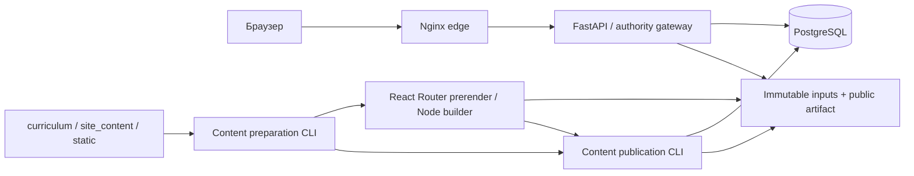
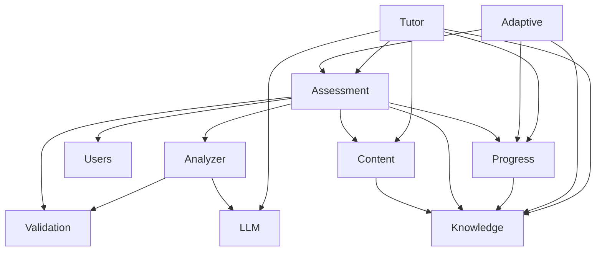

# Архитектура MathStart

Редакция 20.10.2026, Europe/Moscow. Единственный основной архитектурный документ.
Состояние реализации проверено на `1a015f7513933901e8bb252e94c660e4383b6b0e`;
принятая история — в [maintenance](docs/maintenance.md).
Назначение продукта — [PRODUCT.md](PRODUCT.md), полные требования —
[сохранённые требования учебного цикла](specs/product/learning-requirements.md), порядок разработки —
[AGENTS.md](AGENTS.md), очередь — [docs/tasks/INDEX.md](docs/tasks/INDEX.md).

## Реализованная текущая архитектура

Перенос существующего сайта на FastAPI/React принят в PR54, консолидация PR55
завершена. Это модульный монолит с одной основной PostgreSQL БД. Контейнеры
API, edge и одноразовый builder имеют разные эксплуатационные роли, но не
превращают домены в микросервисы. Интеллектуальные Knowledge, Assessment,
Progress, Analyzer, Tutor, Adaptive и продуктовые LLM пока существуют как
контракты, fixtures и pure reference, без продуктовой persistence/API.



Каждый публичный запрос pin-ит один authoritative release. Nginx направляет
запросы в gateway, не обходит его filesystem alias. API проверяет descriptor,
digests, gate generation и publication authority; неполная установка остаётся
UNREADY/503. Node генерирует весь HTML body/head заранее и не работает как
постоянный SSR server. Public HTML читается без JavaScript.

### Текущие пакеты и источники

```text
backend/
  content/          источники, подготовка, проверка, build/publication authority
  users/            identity, profile/onboarding, sessions, cutover, initial operator
  staff/            authorization, reads/writes, publication presentation
  models/           SQLAlchemy baseline и protocol tables
  infrastructure/   database, короткая UnitOfWork, HTTP transport/signing
  migrations/       Alembic и проверяемые fresh/adoption профили
  release_migrate.py явные preview/apply/check
frontend/
  src/app/          React routes/layouts, account/staff, LessonHost
  build_public.py   проверенный immutable public build
  rendering.py      совместимая content/rendering проекция
curriculum/         lesson.json + authored HTML/CSS/JS/SVG
site_content/       каталог, public pages, redirects, reviewed seed media
static/             общие styles/widgets/assets
deploy/             Dockerfile, Compose, edge, release/recovery runbooks
scripts/            проверки продукта и локальные инструменты
specs/              contracts, schemas, fixtures, preservation
docs/tasks/         единый реестр; skills/tasks/ — подробные задания
```

Пакеты будущих доменов появятся внутри `backend/` по мере реализации, со своими
service interfaces, persistence и tests. Пустые каталоги ради схемы не создаются.
`docs/architecture.md` — справочный указатель Content; основной архитектуры там нет.

### Content и публикация

Content владеет Grade, Subject, Section, ContentPage, LessonPublication,
redirects, media и будущим TopicSkill. Тема — ContentPage типа TOPIC;
второй Topic model не создаётся. Файлы `curriculum/` и `site_content/` —
источник авторского контента; source-managed content view-only в staff UI.
Учебные материалы 5–10 классов, URL, якоря, формулы, SVG и интерактивы сохраняются.

Фактический путь: `backend.content.publish prepare-sources/prepare-bootstrap`
→ immutable input + edition handoff → `frontend.build_public` → `plan` →
review → `publish`. Обычные operator команды отличаются от disposable fixture
bootstrap. Источники проверяются до SQL patch; публикация conflict-aware и
idempotent, не сбрасывает пользователей. Staging, PostgreSQL journal/gate,
lease/owner/fencing, один domain commit, descriptor activation и реальные
HTTP probes образуют единый протокол. После неизвестного COMMIT или activation
нет догадки об успехе; recovery читает durable authority и движется вперёд,
не повторяя committed domain update. Старые releases/архивные строки сохраняются.

Полные команды и mount layout:
[READ_RUNTIME](backend/READ_RUNTIME.md), [release](deploy/RELEASE.md),
[редактирование уроков](docs/editing-lessons.md).
Полный mutable media root резервируется вместе с БД и immutable release tuple.

### Identity, HTTP и staff

Identity реализована в `backend/users/`, HTTP — FastAPI с явными DTO и закрытыми
schemas. Сохранены существующие user/profile IDs и исторические auth tables.
Encoded password hashes проверяет независимый совместимый verifier с сохранёнными
лицензионными notices; Django runtime для этого не устанавливается.
Sessions — opaque PostgreSQL sessions. Session rotation, logout/expiry/revocation,
CSRF/Origin/Host, owner-bound idempotency receipts и cutover bridge проверяются
сервером. Принятый cutover допускает явный повторный login; старые sessions
не превращаются в target authentication без предусмотренного proof.

Регистрация UI ограничена 30 символами username, backend сохраняет предел 150
и вход существующих длинных имён. Пароли не передаются в argv, public build,
browser storage или отчёты. Onboarding хранит START_ZERO/SELF_REPORT/DIAGNOSTIC
как выбор; текущий сайт не запускает будущую диагностику и не пишет mastery.

Staff UI использует native React account/admin shells и отдельные API;
каждый API повторяет authorization. Девять staff resources имеют сохранённые
permissions; семь Content resources view-only. User/Group mutations поддерживают
revision/permission-bound подтверждения, PROTECT и безопасный password flow.
Это текущая замена прежнего Django Admin, а не новое право на произвольную SQL.
Initial operator создаётся отдельной maintenance CLI только в fresh unused DB;
startup не создаёт операторов и не меняет схему.

`/api/v1/` — versioned namespace. Frozen OAS содержит и будущие операции;
наличие endpoint в schema не доказывает работающий endpoint.
[Runtime routes](specs/migration/r02-v1/implemented-routes-v1.json),
[контракты HTTP](specs/api/MS7-R02A-http-eligibility.md) и
[staff/content addenda](specs/migration/r02-v1/README.md) задают границы.

### React, SSG и маршрутизация

`frontend/react-router.config.ts` задаёт `ssr: false`,
`routeDiscovery.mode: initial` и `prerender` из проверенного public manifest.
`frontend/src/app/routes.ts` регистрирует точные public paths, `/account/`,
`/admin/*` и development-only gallery. Неизвестный/unpublished URL получает
предусмотренный 404, а не общий SPA 200. Private shells anonymous, no-store;
личные данные загружаются через авторизованные API.

LessonHost сохраняет authored HTML и dependencies; lifecycle/full-document
navigation не должен дублировать scripts или терять widgets. Общие authored
CSS/JS остаются в static. Существующие self-checks могут содержать прежние
reveal interactions прямо в HTML; они не создают assessed evidence и не доказывают
соблюдение будущего server-only exercise API.

## Технологический стек и версии

Таблица описывает файлы репозитория, не latest и не автоматически измеренные
версии пользовательской среды. Pinned dependency отличается от диапазона и
от конкретного runtime. Новые UI-библиотеки не выбраны; Next.js не используется.

| Технология | Назначение | Зафиксировано / диапазон | Источник |
| --- | --- | --- | --- |
| Python | Backend, CLI, QA | Документированный target 3.12+; CI 3.12 без patch; Docker tag 3.12-slim-bookworm + digest, patch не указан в tag | `deploy/Dockerfile`, workflows, `docs/target-runtime.md` |
| FastAPI | HTTP приложение | 0.115.12 exact | `backend/infrastructure/http/requirements.lock` |
| Pydantic / core | DTO/schema validation | 2.11.4 / 2.33.2 exact | Тот же lock |
| Starlette / Uvicorn | ASGI / server | 0.46.2 / 0.34.2 exact | Тот же lock |
| SQLAlchemy | Models, repositories, UoW | 2.0.46 exact | `backend/requirements.lock` |
| Alembic | Reviewed migrations | 1.18.4 exact | Тот же lock, `backend/alembic.ini` |
| psycopg / binary | PostgreSQL driver | 3.3.6 exact | Backend и verification locks |
| PostgreSQL | Основная БД | Target 16+; CI `16-bookworm` без patch; Compose image задан digest, tag/patch не заявлен | `deploy/compose.yaml`, `.github/workflows/migration-ci.yml` |
| Node.js | Build/prerender/QA | Manifest >=24.0.0 <25; Docker 24.21.0 + digest; CI 24.21.0 | `frontend/package.json`, Dockerfile, workflows |
| npm | Locked frontend install | engines >=11 <12; packageManager и Docker 11.19.0 exact | `frontend/package.json`, Dockerfile |
| React / React DOM | UI | 19.2.8 exact | `frontend/package.json`, `package-lock.json` |
| React Router / node / dev | Routes, framework SSG | 7.18.4 exact | Те же manifests и `react-router.config.ts` |
| TypeScript / Vite | Types / build | 5.9.3 / 7.3.7 exact | Frontend manifests |
| Vitest / jsdom | Frontend units | 4.1.11 / 27.4.0 exact | Frontend manifests |
| Testing Library React / DOM | Component tests | 16.3.0 / 10.4.1 exact | Frontend manifests |
| Playwright | Browser QA | 1.58.2 exact; browser binaries фиксируются фактическим run | Frontend manifests, Playwright config |
| AJV / ajv-formats | Frontend schema checks | 8.20.0 / 3.0.1 exact | Frontend manifests |
| openapi-typescript | Generated API types | 7.13.0 exact | Frontend manifests |
| jsonschema | Backend/contracts QA | 4.26.0 exact | HTTP и verification locks |
| BeautifulSoup / soupsieve | Content inspection | 4.15.0 / 2.10 exact | `backend/requirements.lock` |
| argon2-cffi / bcrypt | Retained password algorithms | 25.1.0 / 4.3.0 exact | HTTP lock, `backend/users/THIRD-PARTY-NOTICES.md` |
| HTTPX / httpcore | HTTP client/probes/tests | 0.28.1 / 1.0.9 exact | HTTP lock |
| unittest | Backend/pure tests | Python standard library, версия runtime | `scripts/run_unittest.py`, backend suites |
| Nginx | Edge | `stable-bookworm` + digest; numeric patch в Dockerfile не указан | `deploy/Dockerfile` |
| Docker / Compose | Images, owned local/disposable lifecycle | Docker exact не закреплён; optional TLS override требует Compose 2.24.4+ | `deploy/RELEASE.md`, Compose files |
| GitHub Actions | CI | checkout/setup-python/setup-node/upload-artifact и другие actions по фактическим workflow refs; не runtime библиотеки | `.github/workflows/*.yml` |

Root `requirements.lock` включает HTTP lock, тот включает backend lock.
Backend test locks включают те же exact dependencies. Verification tooling lock
остаётся нужен jsonschema/psycopg проверкам после вывода Harness. Transitive
зависимости перечислены в lock-файлах; обновление версий в этом поручении не делалось.
SymPy и provider SDK не установлены как продуктовые зависимости: вводятся
отдельной будущей задачей с выбранными совместимыми pins и проверками.

## Принятые доменные границы будущей системы

Это обязательные ограничения будущей реализации, а не перечень работающих
модулей. ADR-0002/0003, R02, R03 и HTTP/CompletionFact addenda сохраняют точную
семантику и собственный status. Proposed пункты addenda требуют явного закрытия
решений перед реализацией; принятие миграции не утверждает весь новый продукт.



Стрелки обозначают service dependencies, не право менять чужие ORM models.

| Домен | Владеет | Граница |
| --- | --- | --- |
| Content | Topics, TopicSkill, publication | TopicSkill зависит от стабильного Knowledge.Skill |
| Users | Identity, Profile, selected grade/onboarding | Не владеет знаниями |
| Knowledge | Skill, SkillDependency, graph version | Нет зависимости от Content/Progress; code immutable |
| Assessment | Exercise/Version/Validation/Skill, Attempt/Step/Event, Exposure, AnalysisRecord, Diagnostics, authoritative CompletionFact | Передаёт immutable evidence DTO в Progress |
| Math Validation | Parser, normalizer, validators | Pure/domain interfaces, без DB/LLM requirement |
| Analyzer | Evidence classification, taxonomy, confidence gates | Возвращает результат Assessment; не пишет UserSkillState |
| Progress | ProgressEvent, CompletionFact mirror, UserSkillState, replay | Единственный writer долгосрочного знания; не импортирует Assessment models |
| Adaptive | Selection policy, PracticeSession/Item | Читает состояние, выбирает practice, не начисляет mastery |
| Tutor | Context/policy, Conversation/Message | Только read projections и Assessment help API |
| LLM infrastructure | Provider abstraction, AIRun, prompts, bounded retries | SDK изолирован; не имеет domain ORM write access |

### Репозиторные и пользовательские данные

Восстанавливаемые источники: curriculum, site_content, media seed, будущие
curated skills/edges/exercises/taxonomy/validation definitions.
Runtime history: users/profiles/sessions, attempts/steps/events/exposure,
diagnostics, ProgressEvents/completions, practice, conversations/AIRun.
Bootstrap/seed валидирует полный пакет и не перезаписывает runtime history.
Referenced historical versions архивируются, не удаляются каскадом.

### Knowledge

Skill имеет stable unique code, name/description, grade applicability,
active/archive state и graph version. SkillDependency направлен prerequisite
→ dependent; unique pair, bounded strength/controlled type, без self-edge/cycle.
Graph `pilot-v1`: 10 skills / 13 edges, weight 1.0. `basic_arithmetic` —
внешний prerequisite, не одиннадцатый узел и не dangling FK.
Ancestor query идёт назад до depth 2 с deterministic ordering.
TopicSkill принадлежит Content, включает role/importance/order/version.

### Assessment и четыре режима

Exercise — стабильная identity; ExerciseVersion — immutable published statement,
mode, difficulty, public schemas/parser profile/reveal policy и provenance.
ExerciseValidation хранит server-only answer key/spec/canonical solution/variants
отдельно от public DTO. Один PRIMARY skill в pilot coverage; secondary не
закрывает ту же квоту повторно.

Режимы ровно SELF_CHECK, FINAL_ANSWER, STEP_BY_STEP, STRUCTURED_SOLUTION.
SELF_CHECK не даёт scored submit/mastery. FINAL_ANSWER доказывает final verdict,
но неверное число не локализует misconception. STEP_BY_STEP хранит typed ordered
steps и проверенный prefix. STRUCTURED_SOLUTION использует versioned schema,
unknown schema возвращает controlled unsupported.

Attempt связан с user/version/snapshot/revision и timestamps. SolutionStep
хранит stable step_id, step_no, type, raw_text/payload, normalized_repr,
parse_status; UNIQUE(attempt,step_no). После submit revision immutable.
Hint/reveal/retry — append-oriented AttemptEvents. Exposure фиксируется
по user + immutable exercise version между попытками: новый attempt не
восстанавливает независимость. Полный reveal запрещает CORRECT_FIRST_TRY.
Существенные hints учитываются даже при следующей попытке.
Public GET не раскрывает answers/checkers/canonical solutions в HTML/JSON/JS/cache.

### Детерминированная математика и Analyzer

Raw input сохраняется отдельно; нормализация/whitelist lexer/собственный AST
предшествуют exact rational/transition/domain validation. Никакого eval/exec
или прямого sympify произвольной строки. Parse outcomes: OK, INVALID,
UNSUPPORTED, NOT_REQUIRED. Unsupported/invalid/timeout не являются
доказанной misconception. Ограниченный pilot: числа/рациональные выражения,
знаки, скобки, подобные члены, линейные уравнения; nonlinear/variable
denominator/OCR/geometric proofs вне поддержки.

Первый доказанный неверный переход определяется только на проверенном prefix.
После unsupported gap причинность следующего шага не предполагается.
Cascading consequences не дают повторный штраф. Taxonomy codes контролируются;
OTHER означает safe explanation/abstain. LLM не меняет deterministic verdict.
Schema validation, существующие skill/taxonomy/evidence refs и confidence gate
обязательны; confidence >=0.8 сам по себе недостаточен. Malformed/low confidence/
unknown references дают safe non-strong result. Сохраняются parser/validator/
taxonomy/prompt/model versions. Numeric limits и eval denominators — в ТЗ §§9/15/16.

### Progress и CompletionFact

Только Progress меняет UserSkillState через валидированные ProgressEvent.
KnowledgeEvent в старых источниках — прежний термин, не второй event log.
Event содержит user/skill/type, strength, source/evidence identity, difficulty,
independence/hint/reveal flags, confidence, UTC time и policy version.
State содержит mastery/confidence, evidence_count/status, last_updated,
reducer_version; UNIQUE(user,skill), numeric range [0,100].

Точные deltas, Decimal/ROUND_HALF_UP до двух знаков после каждого event,
difficulty/repeat factors, threshold order, self-report 60/15 один раз,
recent-ten и отсутствие decay сохраняются из
[R03](specs/progress/R03-progress-contract.md).
Online и replay равны по всем полям. Exact source duplicate — no-op;
тот же ключ с иным payload — conflict. Late events переигрывают user+skill,
порядок (occurred_at,event_id,policy_version). Один дефект не создаёт пару
WRONG + MISCONCEPTION. Reveal не становится независимым положительным evidence.

Assessment владеет authoritative CompletionFact; Progress принимает immutable DTO,
хранит mirror и status-only stream. Neutral completions занимают место в recent
ten, но не меняют numeric state/evidence_count/last_updated.
Dual identity completion_id и attempt+skill проверяется глобально, не
изолируется owner partition. progress-v1 сохраняется для истории; progress-v1.1
требует принятого addendum и parity без изменения чисел.

### Транзакции, idempotency и API

SQLAlchemy Session принадлежит короткой UnitOfWork, не разделяется между
threads/tasks. Согласованные изменения используют одну transaction; locks
берутся в стабильном порядке. Future submit: auth/CSRF/owner/schema/idempotency
→ lock attempt/exposure и freeze revision → computation/LLM вне долгой
транзакции → recheck snapshot/policy, atomic analysis/completion/event/projection
finalization → persisted response. Повтор не создаёт вторую историю.
Progress не получает прямую зависимость от Assessment ORM.

Новые PK — UUID там, где это определено контрактом; existing Content IDs/slugs
сохраняются. UTC aware timestamps, exact Decimal и relational FK/constraints;
JSON/JSONB используется для versioned payloads, не вместо нормальных связей.
Уникальны version, step number, source identity и user/skill projection.
Permanent evidence uniqueness переживает >=7-day receipt retention.

DTO не сериализует ORM автоматически. Student resources owner-scoped; foreign
объект возвращает предусмотренный generic 404. CSRF на browser mutations,
stable codes/envelopes/400/401/403/404/409/429/503 по контракту; framework
defaults 422/307/coercion не заменяют frozen HTTP policy.
UI не пересчитывает authoritative knowledge. Conflicts/retry/unknown outcomes
восстанавливаются чтением canonical state; unsupported не отображается как wrong.

### Tutor, Product LLM и adaptive practice

Tutor hint-first. До reveal модель выбирает schema-valid intent/hint_id/level
из reviewed hint bank; сервер проверяет scope/exposure, записывает help и затем
раскрывает подготовленный текст. Answer/checker/private solution не включается
в pre-reveal prompt. После reveal — bounded escaped explanation/fallback.
Context использует минимальные read projections theory/skills/mistakes/history;
LLM/Tutor не пишут mastery. Provider interface изолирует SDK, таймауты,
bounded retries, error normalization, structured validation и AIRun.
Обычный CI offline; live acceptance требует отдельного выбора provider/model,
budget/privacy решения и redacted evidence.

Diagnostic <=10 items; skip/reveal не дают fake independent evidence.
Adaptive читает weak prerequisites, depth <=2, deterministic selection/reasons,
limits и repeat policy из ТЗ. Practice сохраняет origin/target/return context,
одну active session, immutable выбранные items, counters/status. Refresh/next/
finish idempotent. No candidate не вызывает бесконечный цикл; архивный origin
возвращает к published parent/catalogue. Success и max7/streak правила проверяет
сервер. Practice results проходят обычный Assessment → Progress path.

## Данные, эксплуатация и проверки

PostgreSQL — основной runtime; ошибка соединения не включает SQLite fallback.
Явный ограниченный SQLite opt-in не доказывает PostgreSQL locks/concurrency.
Новая схема — reviewed additive Alembic; applied history, retained tables,
PK/FK/sequence identities и Django migration history сохраняются.
Fresh install и adoption A/B/C проверяются по [release](deploy/RELEASE.md).
Startup не выполняет DDL/bootstrap/operator seed. Нельзя править применённую
migration или stamp ради PASS. Destructive changes требуют отдельного решения.

Compose: два API worker, non-root, read-only roots, cap-drop, внутренние DB/API,
только loopback edge port. Forwarded headers доверены ровно reserved edge IP,
не '*'. TLS/ingress/firewall/domain/secrets/operator ownership решаются перед
реальным deployment. Секреты — private env/store; public output не содержит
passwords/tokens/DSN/cookies/student PII. Request IDs связывают наблюдаемые
операции; AIRun metadata не включает чувствительные prompts и ответы.

Recovery tuple: PostgreSQL/data/history/WAL/role identities, весь mutable media
root, immutable input/frontend, manifests/digests/receipts, verifier keys/cutover
binding. Physical backup/restore сохраняет DB/role OIDs. После target writes
старый snapshot не подменяет текущие данные. Совместимый app switch или reviewed
forward recovery выполняется по [RECOVERY](deploy/RECOVERY.md); pre-admission
legacy return — отдельная узкая процедура с fencing, не разрешение dual writer.

`python scripts/verify_repo.py` — 15 product checks; `--profile pure` —
5 portable suites. Математические reference, schema/protocol, auth/security,
PG/service/content, frontend type/unit/build/browser, install/fresh/upgrades,
physical recovery и combined CI сохраняются. Empty/skipped/flaky/missing/timeout
fail. Требования/команды — [target-runtime](docs/target-runtime.md).
CI никогда не требует live LLM или production credentials.

Layering будущих tests: unit/domain (graph/parser/validator/reducer/selector),
PG model/service/constraint/concurrency, HTTP owner/CSRF/secrecy/retry,
golden deterministic/fake provider, real browser/no-JS/responsive/accessibility.
Семантические content/URL/math checks сохраняются при редизайне; visual baselines
обновляются только под принятое направление. Самопроверка и отдельное ревью
различаются; human acceptance не выводится из количества tests.

Performance targets остаются API p95 <500ms, AI p95 <15s, с объявленными cohorts,
условиями/denominators, failures/timeouts и nearest-rank p95 из ТЗ.
Локальные исторические measurements не являются production SLO.
Сначала bounded queries/indexes/SQLAlchemy loading, затем обоснованные
изменения; Redis/Celery/microservices не вводятся автоматически.

## Предложения, требующие решения

Внешний вид главной, каталога и учебной страницы утверждён 23.10.2026.
[UI contract](docs/ux/shared-ui-contract.md) фиксирует систему. Реализация пока
частично prototype; основной runtime не получил новый renderer автоматически.
[Стандарт переноса](docs/frontend/lesson-migration.md) описывает целевую структуру,
versioned content document, общий chrome, интерактивы и selective hydration.
MS-T001 вводит renderer_version/lesson_document в validated immutable delivery,
единый Content route registry и React LessonPage для линейного пилота. Проверки,
review и человеческая приёмка учитываются отдельно. Полноценные карточки
MS-T001–MS-T011 задают pilot, public pages, классы, auth/staff и очистку.
Новых UI kits/Next.js не вводить. Server Identity сохраняется; старые account
UI/fixtures не являются образцом и заменяются в MS-T009 после email/username решения.

Геймификация — новое направление проектирования. XP, уровни, достижения,
серии, daily tasks, персонаж/награды — кандидаты. Педагогическая цель, начисления,
retry/hint/reveal semantics, anti-duplicate, presentation и data owner/storage/events
требуют спецификации и решения. Игровой прогресс отделён от знания; чтение,
серия посещений и XP не увеличивают mastery. Реализованного reward domain нет.

Открыты provider/model/budget, public host/region, privacy/retention реальных
учеников и оформление курса. Они не заполняются догадками.
Собственный Engineering Harness снят с плана и удалён; Codex runtime,
task skills и проверки продукта остаются. История — в Git; текущая очередь — docs/tasks/INDEX.md.
Обычная разработка: одно задание/ветка/исполнитель, PR, отдельное ревью,
исправления, человеческая приёмка, решение о merge, остановка.

## Политика изменений

Значимое изменение ownership, datastore, trust boundary, exercise/progress
semantics, provider/security/deployment оформляется ADR/contract addendum и
проверяется на fresh/upgrade и compatibility по применимости. Принятие
платформы не является разрешением future Product Gates или production rollout.
Исключены из автоматического MVP: OCR, arbitrary geometry/proofs, full-site RAG,
BKT/IRT, teacher/parent dashboards, payments, voice/native apps, Neo4j и
необоснованные queues/caches. Новое поручение определяет ровно один следующий
increment из единого реестра.
